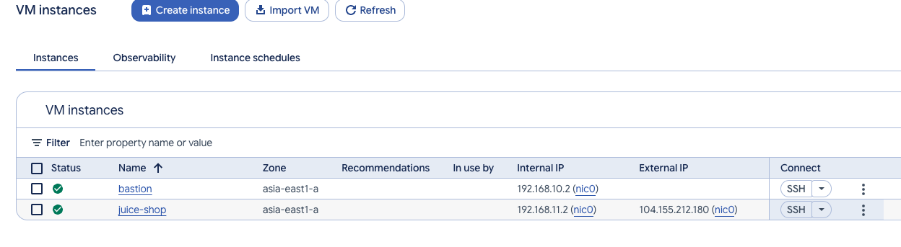
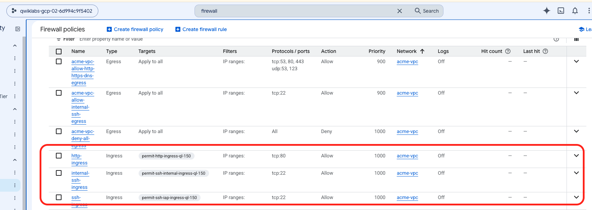
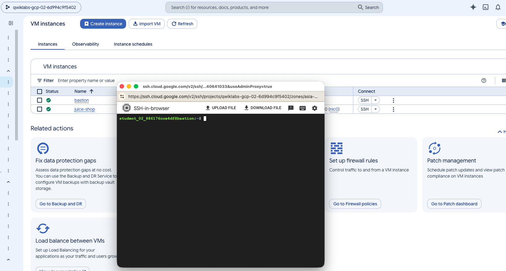

# Task 1 : Remove the overly permissive rules

# Task 3 : Create a firewall rule that allows SSH (tcp/22) from the IAP service and add network tag on bastion
# Task 4 : Create a firewall rule that allows traffic on HTTP (tcp/80) to any address and add network tag on juice-shop
# Task 5: Create a firewall rule that allows traffic on SSH (tcp/22) from acme-mgmt-subnet network address and add network tag on juice-shop

# TASK 6: ssh [Internal IP address of juice-shop]

